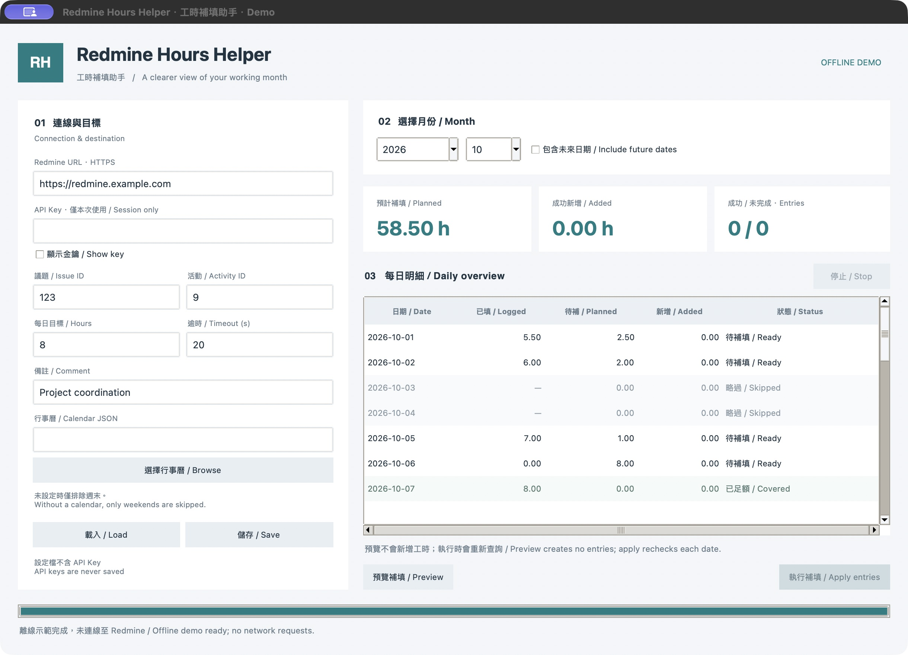

# Redmine Hours Helper · 工時補填助手

**先看清楚，再補工時。 / Preview your month before filling the gaps.**

使用 Python 與 Tkinter 製作的桌面與命令列工具，查詢目前使用者的每日 Redmine 工時，預覽與每日目標的差額，經確認後將差額新增至指定議題。

A Python desktop and command-line tool that reads your daily Redmine time entries, previews the gap against a daily target, and creates the missing entries on a chosen issue after confirmation.

> 預設只預覽。範例不含真實網址、金鑰或公司行事曆。請只登錄實際工作且符合組織規則的工時。
>
> Preview is the default. Examples contain no real server, credentials, or company calendar. Record only actual work in accordance with your organization's rules.



## 功能 / Features

- **GUI 與 CLI 共用邏輯 / Shared GUI and CLI logic** — 同一套設定、日期規則與補填計算。 One implementation for settings, calendars, and calculations.
- **預覽後送出 / Preview before apply** — 每日明細、待補總計、成功時數與未完成筆數。 Daily rows, planned hours, confirmed hours, and unfinished entries.
- **執行前重新查詢 / Recheck before writing** — 差額變少時減少補填，變多時停止並要求重新預覽。 Smaller gaps reduce the write; larger gaps require a new preview.
- **完整分頁與使用者核對 / Complete reads and user verification** — 檢查日期、使用者、重複資料及分頁一致性。 Validate dates, user ownership, duplicate entries, and pagination consistency.
- **自訂日期規則 / Custom calendar** — 完整年份的休假日與週末補班日，預設排除未來日期。 Year-specific holidays and weekend working days; future dates are excluded by default.
- **保持畫面回應 / Responsive interface** — 背景網路工作、進度列與停止按鈕。 Background requests, progress, and cancellation.
- **金鑰不落地 / No saved API keys** — GUI 暫存輸入或 `REDMINE_API_KEY` 環境變數。 Use a session-only GUI field or an environment variable.

## 需求 / Requirements

- Python **3.11+**；GUI 需要 Tkinter 與桌面環境。 Python **3.11+**; the GUI also needs Tkinter and a desktop display.
- 可透過 HTTPS 存取的 Redmine，已啟用 REST API，且帳號有讀取自身工時與在目標議題登錄工時的權限。 An HTTPS Redmine server with REST API enabled and permission to read your time entries and log time on the target issue.
- 執行時唯一第三方 Python 套件為 `requests`。 The only third-party runtime Python dependency is `requests`.

REST API 啟用位置為 **Administration → Settings → API**，API Key 可於個人帳號頁面取得；登入驗證使用 `X-Redmine-API-Key` 標頭。 Enable REST API under **Administration → Settings → API** and find your key on your account page. Authentication uses the `X-Redmine-API-Key` header. [Redmine API documentation](https://www.redmine.org/projects/redmine/wiki/Rest_api)

## 安裝 / Installation

下載或 clone 此儲存庫後，在專案根目錄執行。 After downloading or cloning this repository, run these commands from its root directory.

### macOS / Linux

```bash
python3 -m venv .venv
source .venv/bin/activate
python -m pip install -e .
cp config.example.json config.local.json
cp calendar.example.json calendar.local.json
```

### Windows · PowerShell

```powershell
py -3 -m venv .venv
.\.venv\Scripts\python.exe -m pip install -e .
Copy-Item config.example.json config.local.json
Copy-Item calendar.example.json calendar.local.json
```

Windows 下可直接使用 `.\.venv\Scripts\python.exe`，不必修改 PowerShell 執行政策。 On Windows, use the virtual environment's Python directly; no PowerShell execution-policy change is necessary.

檢查 Tkinter：`python -m tkinter`。若未安裝，請為目前使用的 Python 安裝對應 Tk 支援；Linux 通常由系統套件提供，macOS 請確認 Tk 與 Python 版本相符。純 CLI 不需要 Tkinter。

Check Tkinter with `python -m tkinter`. If it is missing, install Tk support for the Python interpreter you use. Linux commonly provides it as a system package; on macOS, match Tk to your Python version. The CLI works without Tkinter.

## 設定 / Configuration

編輯 `config.local.json`，或在 GUI 填入欄位後使用「儲存」。`*.local.json` 已由 Git 排除；範例值必須換成你自己的設定。

Edit `config.local.json`, or fill in the GUI and select **Save**. Git ignores `*.local.json`. Replace the example values with your own settings.

```json
{
  "redmine_url": "https://redmine.example.com",
  "issue_id": 123,
  "activity_id": 9,
  "daily_hours": 8,
  "comment": "Project coordination",
  "holidays_file": "calendar.local.json",
  "timeout_seconds": 20
}
```

| 欄位 / Field | 說明 / Meaning |
| --- | --- |
| `redmine_url` | Redmine 的 HTTPS 基底網址，可含子路徑，例如 `https://example.com/redmine`；不要填 API endpoint、帳密或 query。 HTTPS base URL, optionally with a subpath; no endpoint, credentials, or query. |
| `issue_id` | 新增工時的目標議題 ID，正整數。 Positive integer ID of the destination issue. |
| `activity_id` | 該專案允許的工時活動 ID，正整數。 Positive integer ID of a time-entry activity available in the project. |
| `daily_hours` | 每日目標，預設 8；大於 0、最多 24、最多兩位小數。 Daily target, default 8; > 0 and ≤ 24, up to two decimals. |
| `comment` | 每筆新增紀錄的備註，最多 255 字元。 Comment for new entries, at most 255 characters. |
| `holidays_file` | 行事曆 JSON 路徑；相對路徑以設定檔所在目錄解析。空字串表示僅排除週末。 Calendar JSON path, relative to the config file; empty means weekends only. |
| `timeout_seconds` | 每次請求的讀取逾時，1–120 秒；連線逾時最多 5 秒。 Per-request read timeout, 1–120 seconds; connection timeout is at most 5 seconds. |

API Key **不放在 JSON**。GUI 可直接輸入且不會儲存；CLI 若未設定 `REDMINE_API_KEY`，會在互動終端以隱藏輸入提示讀取。非互動使用需要環境變數。

Do **not** put the API key in JSON. Enter it in the GUI without saving it, or let the CLI prompt for it using hidden input. Non-interactive CLI runs require the `REDMINE_API_KEY` environment variable.

議題 ID 可從議題網址取得；活動 ID 可由管理者提供或透過 `/enumerations/time_entry_activities.json` 查詢，再確認目標專案允許使用。 Issue IDs appear in issue URLs. Obtain activity IDs from an administrator or `/enumerations/time_entry_activities.json`, and confirm that the project allows the activity. [Redmine enumerations](https://www.redmine.org/projects/redmine/wiki/Rest_Enumerations)

## 桌面操作 / Desktop workflow

```bash
python -m redmine_hours_helper --gui
# 或 / Or:
python gui_tkinter.py
# macOS / Linux:
./run_gui.sh
```

Windows：`.\.venv\Scripts\python.exe -m redmine_hours_helper --gui`

1. 填入 HTTPS 網址、API Key、議題與活動 ID。 Enter the HTTPS URL, API key, issue ID, and activity ID.
2. 確認每日目標、備註、行事曆與月份。 Review the target hours, comment, calendar, and month.
3. 按「預覽補填」，查看每日已填與待補時數。 Select **Preview** and review logged and planned hours.
4. 預覽完整且無錯誤後，「執行補填」才會啟用；確認筆數與時數後送出。 **Apply entries** is enabled only after a complete, error-free preview. Confirm the number of entries and hours.
5. 查看成功新增與未完成數；點選日期可查看詳細原因。 Review confirmed hours and unfinished entries; select a date for details.

修改任何設定會使預覽失效。執行完畢或停止後，必須重新預覽才能再次補填。停止會等待當前操作結束，已建立紀錄不會撤回。

Changing any setting invalidates the preview. After applying or stopping, preview again before another write. Stop waits for the in-flight operation and does not roll back created entries.

不需要帳號即可看介面：離線示範只使用虛構資料，不會連線或寫入 Redmine。

Try the interface without an account: the offline demo uses synthetic data and cannot connect to or write to Redmine.

```bash
python -m redmine_hours_helper --gui --demo
```

## 命令列 / Command line

```bash
# 預覽，完全不新增工時 / Preview without creating entries
redmine-hours --year 2026 --month 10
redmine-hours --year 2026 --month 10 --dry-run

# 顯示預覽後，輸入 yes 才送出 / Review preview, then type yes to apply
redmine-hours --year 2026 --month 10 --apply

# 非互動送出；須預先設定 REDMINE_API_KEY / Non-interactive, requires the environment variable
redmine-hours --year 2026 --month 10 --apply --yes

# 明確允許處理未來日期 / Explicitly include future dates
redmine-hours --year 2026 --month 10 --include-future

# 自訂設定與選填日誌 / Custom config and optional logs
redmine-hours --config config.local.json --log-file logs/run.log

# 舊入口仍可使用 / Legacy launcher remains available
python fill_hours.py --year 2026 --month 10 --dry-run
```

亦可用 `python -m redmine_hours_helper` 取代 `redmine-hours`。年月省略時使用執行電腦的當地日期。`--yes` 必須搭配 `--apply`；它只略過互動確認，不會略過預覽、驗證或重新查詢。

You can replace `redmine-hours` with `python -m redmine_hours_helper`. Omitted year/month use the computer's local date. `--yes` requires `--apply`; it skips only the confirmation prompt, not preview, validation, or rechecking.

結束碼 / Exit codes: `0` 成功或使用者取消 / success or declined confirmation; `1` 設定、API 或部分執行失敗 / configuration, API, or partial-run failure; `2` 參數錯誤 / invalid arguments; `130` 中斷 / interrupted.

## 行事曆規則 / Calendar rules

`calendar.example.json` 刻意保持空白，**不代表任何國家或公司的完整假日清單**。請依年份維護 `calendar.local.json`。以下僅示範格式：

`calendar.example.json` is intentionally empty and **is not an official national or company holiday calendar**. Maintain `calendar.local.json` per year. The following illustrates the format only:

```json
{
  "holidays": ["2030-01-01"],
  "workdays": ["2030-01-05"]
}
```

- `holidays`：排除完整日期，不會套用至其他年份。 Exclude exact dates, without applying them to other years.
- `workdays`：指定週末補班日。 Explicit working days, including weekends.
- 同一日期不可同時出現在兩份清單，格式必須是 `YYYY-MM-DD`。 Lists must be disjoint; dates must use `YYYY-MM-DD`.
- 行事曆不存在或格式錯誤時會停止，不會默默改用空清單。 Missing or malformed calendars stop the operation instead of silently falling back.
- 即使列為補班日，未來日期仍須明確啟用才會處理。 Future working days still require the explicit future-date option.

## 計算與錯誤處理 / Calculation and failure behavior

每日已填工時加總的是 **API 使用者當天所有議題的紀錄**；新增差額才歸入指定議題。既有紀錄不會被修改或刪除。差額最多兩位小數，向下取整以避免超過目標；不足 0.01 小時不新增。

Logged hours include **all issues for the authenticated user on that date**. Only newly created gaps go to the selected issue. Existing entries are never edited or deleted. Gaps are rounded down to two decimals to avoid exceeding the target; gaps below 0.01 hours are not added.

| 狀態 / Status | 行為 / Behavior |
| --- | --- |
| Ready / 待補填 | 有差額，等待確認。 A gap is ready for confirmation. |
| Covered / 已足額 | 已達目標，或差額小於 0.01。 Target met or gap below 0.01. |
| Skipped / 略過 | 休假或預設排除的未來日期。 Non-working day or excluded future date. |
| Added / 已新增 | 已核對伺服器回傳的新紀錄。 Server response matches the new entry. |
| Failed / 失敗 | 查詢失敗或新增被明確拒絕，不算成功時數。 Read failed or write was rejected; not counted as added. |
| Check Redmine / 待核對 | 寫入逾時、伺服器錯誤、重新導向或回應無法驗證；停止且不重送。 Ambiguous write; stop without retrying. |
| Preview again / 需重新預覽 | 差額增加或日期規則改變。 Gap increased or date rules changed. |
| Not run / 未執行 | 使用者停止，或先前日期發生錯誤。 Cancelled or stopped after a preceding error. |

送出遇到第一個錯誤或結果不明就停止後續新增。總計只計入已確認成功的紀錄；待核對的紀錄可能已在伺服器建立，請先到 Redmine 確認，再重新預覽。

Applying stops at the first failure or uncertain outcome. Totals include confirmed entries only. An uncertain entry may already exist on the server: inspect Redmine before generating a new preview.

讀取只允許有限次數的同來源 HTTPS 重新導向；會拒絕不同主機、不同連接埠或附帶查詢參數的轉址。POST 不自動重新導向或重試，請直接設定最終 HTTPS 基底網址。

Reads allow a bounded number of same-origin HTTPS redirects, rejecting different hosts, ports, or query-bearing redirect targets. POST requests are never redirected or retried automatically. Configure the final HTTPS base URL.

API 分頁與新增欄位依據官方文件實作。 Pagination and creation fields follow the official API references: [REST API](https://www.redmine.org/projects/redmine/wiki/Rest_api), [Time entries](https://www.redmine.org/projects/redmine/wiki/Rest_TimeEntries).

## 常見問題 / Troubleshooting

| 現象 / Symptom | 處理方式 / What to check |
| --- | --- |
| 找不到設定 / Missing config | 複製 `config.example.json` 並修改；或使用 `--config`。 Copy and edit the example, or pass `--config`. |
| HTTP 401 / 403 | 確認 API 已啟用、金鑰有效且有讀寫權限。 Check API enablement, key validity, and permissions. |
| HTTP 404 | 檢查基底網址與子路徑。 Check the base URL and any subpath. |
| HTTP 422 | 檢查議題、活動、日期、備註，以及組織額外必填欄位。 Check issue, activity, date, comment, and organization-specific required fields. |
| SSL / 連線失敗 / Connection error | 檢查網路、VPN 與憑證信任。使用組織 CA 時可設定 `REQUESTS_CA_BUNDLE`，不提供停用 TLS 驗證選項。 Check network, VPN, and certificate trust. For a company CA, use `REQUESTS_CA_BUNDLE`; TLS verification cannot be disabled in the app. [Requests TLS documentation](https://requests.readthedocs.io/en/latest/user/advanced/#ssl-cert-verification) |
| 非 JSON 或資料不符 / Unexpected data | 可能是登入頁、反向代理、外掛或不完整分頁；請檢查服務設定。 Check for a login page, reverse proxy, plugins, or incomplete pagination. |
| 執行按鈕未啟用 / Apply disabled | 先完成預覽；有錯誤、沒有待補工時或處於離線示範時不會啟用。 Finish a successful preview; errors, zero gaps, and demo mode disable apply. |
| 無法開啟視窗 / Cannot open window | 檢查 Tkinter、圖形桌面與視窗大小；遠端無桌面環境可使用 CLI。 Check Tkinter and the desktop environment; use CLI on headless machines. |

## 隱私與紀錄 / Privacy and logs

設定檔只儲存非金鑰欄位，但仍可能包含內部網址與議題資訊，請保留為 `*.local.json`。`.gitignore` 同時排除 `.local/`、環境變數檔、日誌、備份、虛擬環境與快取。

Settings omit credentials but may still contain internal URLs and issue details; keep them in `*.local.json`. `.gitignore` also excludes `.local/`, environment files, logs, backups, virtual environments, and caches.

預設不寫日誌；CLI 可用 `--log-file logs/run.log` 啟用輪替紀錄（每檔約 1 MB，保留兩份備份）。只記日期、狀態與成功時數，不記 API Key、HTTP 標頭、伺服器原始回應或備註。

Logging is off by default. The CLI can enable rotating logs with `--log-file logs/run.log` (about 1 MB per file, two backups). Logs contain dates, statuses, and confirmed hours, not keys, HTTP headers, raw responses, or comments.

發布前檢查實際 Git 追蹤的檔案；不要將整個含有本機資料的工作資料夾直接打包上傳。 Before publishing, inspect the actual tracked files; do not upload an archive of a working folder containing local data.

## 架構 / Architecture

```text
src/redmine_hours_helper/
├── __main__.py       # Python module entry point
├── cli.py            # Argument parsing and terminal output
├── config.py         # Validated non-secret settings
├── calendar.py       # Year-specific working-day rules
├── redmine.py        # HTTPS API, pagination and response validation
├── service.py        # Preview, recheck, apply and result models
├── logging_setup.py  # Optional bounded metadata logs
└── gui/
    ├── __init__.py   # Desktop entry points
    ├── app.py        # Views, worker queue and interaction state
    └── theme.py      # Shared ttk visual styles
tests/               # Offline unit and optional GUI integration tests
.github/workflows/   # Lint, tests and package build
```

GUI 與 CLI 呼叫 `HoursService`；服務透過 `RedmineClient` 存取 API。GUI 的網路工作在背景執行緒中，透過佇列回報主執行緒更新畫面。業務邏輯不依賴 Tkinter。

Both interfaces call `HoursService`, which accesses the API through `RedmineClient`. GUI networking runs on a worker thread and sends events through a queue to the main Tk thread. Business logic does not depend on Tkinter.

## 開發與驗證 / Development and verification

```bash
python -m pip install -e ".[dev]"
python -m unittest discover -s tests -v
ruff check .
ruff format --check .
python -m build
```

測試全部使用模擬資料，不需要 API Key，也不會連線至真實 Redmine。GUI 整合測試需圖形環境且須明確啟用：

Tests use synthetic responses, need no API key, and never contact a live Redmine server. GUI integration tests need a display and explicit opt-in:

```bash
RUN_GUI_TESTS=1 python -m unittest discover -s tests -p 'test_gui.py' -v
```

GitHub Actions 設定包含 Linux、macOS、Windows 的核心測試，以及 Linux 虛擬顯示環境的 GUI 測試。實際 CI 結果請查看儲存庫的 Actions 頁面。

GitHub Actions is configured for core tests on Linux, macOS, and Windows, plus GUI tests on a Linux virtual display. See the repository's Actions page for actual run results.

## 已知限制與後續方向 / Limitations and next steps

- **非原子寫入 / Non-atomic writes**：重新查詢與新增之間仍有時間差。請避免多個實例同時補填同一帳號；目前沒有跨程序鎖或伺服器端 idempotency。 A race remains between recheck and creation. Avoid concurrent runs for one account; there is no cross-process lock or server-side idempotency.
- **需自行維護行事曆 / Maintain your calendar**：不會自動下載國定假日，也不會自動計算特休、半天假或彈性工時。 No automatic public-holiday downloads, leave balances, half-days, or flexible schedules.
- **單一補填目標 / One destination**：一次執行使用單一議題與活動；不支援自訂必填欄位、跨帳號代理或多專案分攤。 One issue and activity per run; required custom fields, impersonation, and multi-project allocation are not supported.
- **保守 API 驗證 / Conservative API validation**：修改過回應格式的外掛可能需要適配；單日超過 10,000 筆時會停止查詢。 Plugins that alter response shapes may need adaptation; reads stop above 10,000 entries per day.
- **桌面顯示 / Desktop layout**：目前採固定淺色樣式，建議至少 1080 × 800 的可用視窗空間；未包含安裝包或自動更新。 Light theme; at least 1080 × 800 usable window space is recommended. No bundled installer or automatic updater.

後續可評估：作業系統金鑰圈、官方行事曆匯入、各日不同工時目標、活動選單自動載入，以及桌面安裝包。

Possible future improvements: OS keychain integration, official-calendar import, per-day targets, automatic activity selection, and desktop installers.

## 授權 / License

授權條款尚待維護者選定，目前未附 `LICENSE` 檔案。

The maintainer has not yet selected a license; this repository currently does not include a `LICENSE` file.
